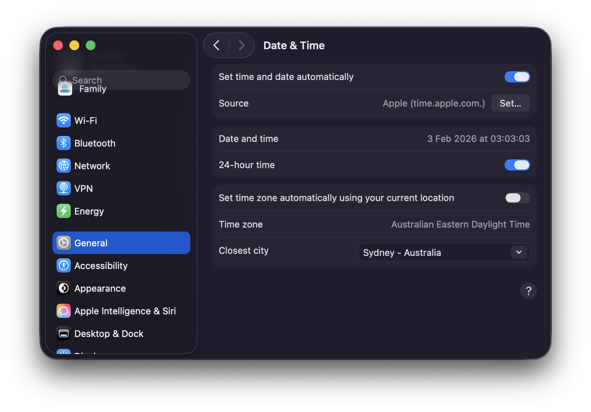

```{r}
#| include: false
#| eval: true
eval_articles <- identical(tolower(Sys.getenv("FFIEC_PQ_EVAL_ARTICLES")), "true")
knitr::opts_chunk$set(
  cache.path = "curate_call_reports_cache/",
  eval = eval_articles
)

article_process_results <- function() {
  data_dir <- Sys.getenv("DATA_DIR", unset = "")
  if (!nzchar(data_dir) || !requireNamespace("arrow", quietly = TRUE)) {
    return(NULL)
  }
  path <- file.path(data_dir, "ffiec", "ffiec_process_data.parquet")
  if (!file.exists(path)) {
    return(NULL)
  }
  arrow::read_parquet(path)
}
article_n <- function(x, fallback = "the generated") {
  if (is.null(x)) fallback else format(nrow(x), big.mark = ",")
}
results <- article_process_results()
```

This article continues the Call Report curation example by showing how to use the Parquet files from R with DuckDB.

# Using the data

## Using the data with R

So what has the `ffiec.pq` package just done?
In a nutshell, it have processed each of the nearly 100 zip files into seven Parquet files, and I discuss these in turn.

### "Panel of Reporters" (POR) data

The first file is the ["Panel of Reporters" (POR) table](https://cdr.ffiec.gov/CDR/public/cdrhelp/Panel%20Of%20Reporters.htm), which provides details on the financial institutions filing in the respective quarter.

To access the data using the `ffiec.pq` functions, we just need to create a connection to an in-memory DuckDB database, which is a simple one-liner.

```{r}
db <- dbConnect(duckdb::duckdb())
```

From there we have the option to load a single Parquet file using the `pq_file` argument of the `ffiec_scan_pqs()` function:^[Note that nothing is being "loaded" into RAM, the file is merely being scanned by DuckDB.]

```{r}
por_20250930 <- ffiec_scan_pqs(db, pq_file="por_20250930.parquet")
por_20250930 |>
  select(IDRSSD, financial_institution_name, everything()) |>
  head() |>
  collect()

por_20250930 |> count() |> collect()
```

But it will generally be more convenient to just read all files in one step, which we can do like this.

```{r}
por <- ffiec_scan_pqs(db, "por")
por |>
  select(IDRSSD, financial_institution_name, everything()) |>
  head() |>
  collect() 

por |> count() |> collect()
```

### Item-schedules data

The second data set is `ffiec_schedules`.
The zip files provided by the FFIEC Bulk Data site comprise several TSV files organized into "schedules" corresponding the particular forms on which the data are submitted by filers.
While the `ffiec.pq` package reorganizes the data by data type, information about the original source files for the data are retained in `ffiec_schedules`.
We can load this using the following code:

```{r}
ffiec_schedules <- ffiec_scan_pqs(db, "ffiec_schedules")
```

And here are the first 10 rows of this data set.

```{r}
ffiec_schedules |> head(10) |> collect()
```

Focusing on one item, `RIAD4230`, we can see from the output below that this item was provided on both Schedule RI (`ri`) and Schedule RI-BII (`ribii`) from `2001-03-31` until `2018-12-31`, but since then has only been provided on Schedule RI-BII.

```{r}
#| eval: false
ffiec_schedules |> 
  filter(item == "RIAD4230") |>
  mutate(schedule = unnest(schedule)) |>
  group_by(item, schedule) |>
  summarize(min_date = min(date, na.rm = TRUE),
            max_date = max(date, na.rm = TRUE),
            .groups = "drop") |>
  collect()
```

The next question might be: What is `RIAD4230`?
We can get the answer from `ffiec_items`, a data set included with the `ffiec.pq` package:

```{r}
ffiec_items |> filter(item == "RIAD4230")
```

Schedule RI is the income statement and "Provision for loan and lease losses" is an expense we would expect to see there for a financial institution. 
Schedule RI-BII is "Charge-offs and Recoveries on Loans and Leases" and provides detail on loan charge-offs and recoveries, broken out by loan category, for the reporting period.
As part of processing the data, the `ffiec.pq` package confirms that the value for any given item for a specific `IDRSSD` and `date` is the same across schedules for *all* items in the data.

Each of the other five files represents data from the schedules for that quarter for a particular data type, as shown in @tbl-types:

| Key   | Arrow type | Access code |
|------:|------------|-------------|
| float | Float64    | `ffiec_scan_pqs(db, "ffiec_float")` |
| int   | Int32      | `ffiec_scan_pqs(db, "ffiec_int")` |
| str   | Utf8       | `ffiec_scan_pqs(db, "ffiec_str")` |
| date  | Date32     | `ffiec_scan_pqs(db, "ffiec_date")` |
| bool  | Boolean    | `ffiec_scan_pqs(db, "ffiec_bool")` |

: Table keys, arrow types, and access code {#tbl-types}

We can use the data set `ffiec_items` to find out where a variable is located, based on its Arrow type.

```{r}
ffiec_items
```

As might be expected, most variables have type `Float64` and will be found in the `ffiec_float` tables.

```{r}
ffiec_items |> count(data_type, sort = TRUE)
```

### Example 1: Do bank balance sheets balance?

If we were experts in Call Report data, we might know that domestic total assets is reported as item `RCFD2170` (on Schedule RC) for banks reporting on a consolidated basis and as item `RCON2170` for banks reporting on an unconsolidated basis.
We might also know about `RCFD2948` and `RCFD3210` and so on.
But we don't need to be experts to see what these items relate to:

```{r}
bs_items <- c("RCFD2170", "RCON2170",
              "RCFD2948", "RCON2948",
              "RCFD3210", "RCON3210",
              "RCFD3000", "RCON3000")

ffiec_items |> filter(item %in% bs_items)
```

The output above suggests we can make a "top level" balance sheet table using these items.
The following code uses the DuckDB instance we created above (`db`) and the code provided in @tbl-types, to create `ffiec_float`, a "lazy" data table.
Here "lazy" is a good thing, as it means we have access to all the data without having to load anything into RAM.
As a result, this operation takes almost no time.

```{r}
ffiec_float <- ffiec_scan_pqs(db, "ffiec_float") |> system_time()

ffiec_float
```

As can be seen, the data in `ffiec_float` are in a **long** format, with each item for each bank for each period being a single row.

I then `filter()` to get data on just the items in `bs_items` and then use the the convenience function `ffiec_pivot()` from the `ffiec.pq` package to turn the data into a more customary **wide** form.
I then use `coalesce()` to get the consolidated items (`RCFD`) where available and the unconsolidated items (`RCON`) otherwise.
Because I `compute()` this table (i.e., actually calculate the values for each row and column), this step takes a relatively long time, but not too long given that the underlying data files are in the order of tens of gigabytes if loaded in RAM.^[Parquet files are compressed, so they use less space on disk than they do when they are loaded into RAM.]

```{r}
bs_data <-
  ffiec_float |> 
  ffiec_pivot(items = bs_items) |>
  mutate(total_assets = coalesce(RCFD2170, RCON2170),
         total_liabilities = coalesce(RCFD2948, RCON2948),
         equity = coalesce(RCFD3210, RCON3210),
         nci = coalesce(RCFD3000, RCON3000)) |>
  mutate(eq_liab = total_liabilities + equity + nci) |>
  compute() |>
  system_time()
```

So, do balance sheets balance?
Well, not always.^[Note that `collect()` here actually brings the data into R; `compute()` merely materializes the data as a table in the DuckDB database.]

```{r}
bs_data |>
  count(bs_balance = eq_liab == total_assets) |>
  collect()
```

What's going on?
Well, one possibility is simply rounding error.
So in the following code, I set `imbalance_flag` to `TRUE` only if the gap is more than `1` (these are in thousands of USD).

```{r}
balanced <-
  bs_data |>
  mutate(imbalance = total_assets - eq_liab,
         imbalance_flag = abs(total_assets - eq_liab) > 1) |>
  select(-starts_with("RC"), -total_liabilities) |>
  collect()
```

This helps a lot.
Now it seems that balance sheets *usually* balance, but not always.

```{r}
balanced |>
  count(imbalance_flag)
```

The vast majority of apparent imbalances are small ...

```{r}
balanced |>
  filter(imbalance_flag) |>
  select(IDRSSD, date, total_assets, imbalance) |>
  arrange(desc(imbalance))
```

... and they're all at least twenty years ago.

```{r}
balanced |>
  filter(imbalance_flag) |>
  select(IDRSSD, date, total_assets, imbalance) |>
  arrange(desc(date))
```

### Example 2: When do banks submit their Call Reports?

Working with dates and times (**temporal data**) can be a lot more complicated than is generally appreciated.
Broadly speaking we might think of temporal data as referring to points in time, or *instants*, or to *time spans*, which include durations, periods, and intervals.^[See @Wickham:2023aa, p. 311-315, for discussion of time spans.]
Instants might refer to *moments in time* (e.g., in UTC) or as *times of day* (in local time).

Suppose I were interested in understanding the times of day at which financial institutions submit their Call Reports.
It seems that financial institutions file Call Reports with their primary federal regulator through the FFIEC's Central Data Repository.
So I am going to use the `America/New_York` time zone as the relevant local time zone for this analysis, as the FFIEC is based in Washington, DC.

To illustrate some subtleties of working with time zones, I will set my computer to a different time zone from that applicable to where I am: `Australia/Sydney`, as seen in @fig-time-zone.^[I am writing this from the Boston area, so it would be insufficiently confusing if I did not make this change to my settings.
In effect, I want to ensure that the code works for someone in a different time zone.]

```{r}
#| label: fig-time-zone
#| eval: true
#| fig-width: 4
#| fig-height: 3
#| out.width: "4in"
#| echo: false
#| fig-cap: |
#|   Setting my computer to a different time zone
#| fig-alt: |
#|   Figure showing that computer has been set to the time zone of Sydney, Australia.

```

Now, R sees my time zone as `Australia/Sydney`:

```{r}
Sys.timezone()
```

If we look at the underlying zip file for `2025-09-30`, you will see that `last_date_time_submission_updated_on` for the bank with `IDRSSD` of `37` is `"2026-01-13T10:13:21"`.
In creating the `ffiec.pq` package, I assumed that this is a timestamp in `America/New_York` time.
 
How does that show up when I look at the processed data in R using DuckDB?

```{r}
db <- dbConnect(duckdb::duckdb())

por <- ffiec_scan_pqs(db, "por")

por_default <-
  por |> 
  filter(IDRSSD == 37, date == "2025-09-30") |> 
  rename(dttm = last_date_time_submission_updated_on) |>
  mutate(dttm_text = as.character(dttm)) |> 
  select(IDRSSD, date, dttm, dttm_text) |> 
  collect()

dbDisconnect(db)

por_default
por_default$dttm[1]
```

By default, R/DuckDB is showing this to me as UTC.
This is fine, but I want to analyse this as a local time.
Here is how I can achieve this.
First, I set the R variable `tz` to `"America/New_York"`.

```{r}
tz <- "America/New_York"
```

Second, I connect to DuckDB anew, but I tell it I want it to use `"America/New_York"` as the time zone of output.
But it's important to note that this is just a "presentation layer" and doesn't change how the database itself "thinks about" timestamps.

```{r}
db <- dbConnect(duckdb::duckdb(), timezone_out = tz)
```

Third, I make DuckDB a "time zone wizard" but installing and loading the `icu` extension.
This extension enables region-dependent collations and time zones.
The `icu` extension is probably not installed and enabled by default because it is large and not all applications need these features.
This allows me to set the DuckDB server's time zone to `America/New_York`.

```{r}
rs <- dbExecute(db, "INSTALL icu")
rs <- dbExecute(db, "LOAD icu")
rs <- dbExecute(db, str_glue("SET TimeZone TO '{tz}'"))
```

Then I run the query from above again.

```{r}
por <- ffiec_scan_pqs(db, "por")
por_ny <-
  por |> 
  filter(IDRSSD == 37, date == "2025-09-30") |> 
  rename(dttm = last_date_time_submission_updated_on) |>
  mutate(dttm_text = as.character(dttm)) |> 
  select(IDRSSD, date, dttm, dttm_text) |>
  collect()

por_ny
por_ny$dttm[1]
```

Now, we see that everything is in `America/New_York` local time, including the way the server sees the data (`dttm_text`) and how it's presented to the R user.

Now that we have things working in local time, I will make a couple of plots of submission times.
To show times on a single scale, I use the fudge of making them all times on a given day, which I somewhat arbitrarily choose to be `2025-01-01`.^[I say somewhat arbitrarily because you probably don't want to choose a day that is missing an hour due to shift from `EST` to `EDT`.]

The first plotting example presents submission times divided by whether banks are located in "western states" or not.
It does seem that western banks file later.

```{r}
western_states <- c("HI", "WA", "CA", "AK", "OR", "NV")

plot_data <-
  por |> 
  rename(last_update = last_date_time_submission_updated_on) |>
  mutate(
    q4 = quarter(date) == 4,
    offset = last_update - sql("last_update AT TIME ZONE 'UTC'"),
    offset = date_part("epoch", offset) / 3600,
    tzone = if_else(offset == -4, "EDT", "EST"),
    west = financial_institution_state %in% western_states,
    ref = sql(str_glue("TIMESTAMPTZ '2025-01-01 00:00:00 {tz}'")),
    sub_date = date_trunc('days', last_update)) |>
  mutate(time_adj = last_update - sub_date + ref) |>
  select(IDRSSD, date, last_update, time_adj, west, q4, offset, tzone) |>
  collect()
```

```{r}
#| label: fig-times-west
#| fig-cap: Submission times by year and region
#| fig-width: 8
#| fig-height: 5
#| echo: false
plot_data |>
  mutate(year = year(last_update)) |>
  filter(year %in% c(2006, 2025)) |>
  ggplot(aes(x = time_adj, fill = west)) +
  geom_histogram(binwidth = 15 * 60) +
  scale_x_datetime(
    date_labels = "%H",
    date_breaks = "2 hours"
  ) +
  labs(x = str_glue("Time of day ({tz})")) + 
  facet_wrap(west ~ year, scales = "free_y") +
  theme(legend.position = "bottom")
```

The second plotting example presents submission times divided by whether `America/New_York` is on  Eastern Daylight Time (EDT) or Eastern Standard Time (EST).
Looking at the plot, it seems that submission times have a similar distribution across the two time zones, suggesting that banks do not follow UTC, in which case there should be a difference in distributions for EDT and EST.

One can definitely see a "lunch hour" and the submissions appear more likely to involve someone clicking a "Submit" button in some software package rather than IT setting up some overnight automated submission.

```{r}
#| label: fig-times-tz
#| fig-cap: Submission times by year and US/Eastern time zone
#| fig-width: 8
#| fig-height: 5
#| echo: false
plot_data |>
  mutate(year = year(last_update)) |>
  filter(year %in% c(2006, 2025)) |>
  ggplot(aes(x = time_adj, fill = tzone)) +
  geom_histogram(binwidth = 15 * 60) +
  scale_x_datetime(
    date_labels = "%H",
    date_breaks = "2 hours"
  ) +
  labs(x = str_glue("Time of day ({tz})")) + 
  facet_wrap(tzone ~ year, scales = "free_y") +
  theme(legend.position = "bottom")
```
